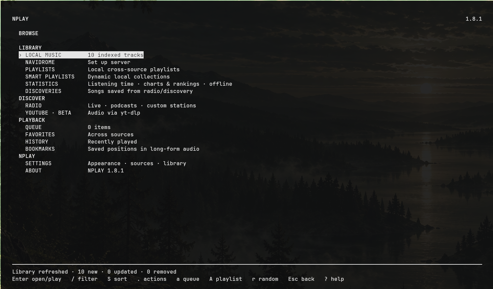

# NPLAY

Minimalist, keyboard-first terminal music, radio and podcast player built around mpv.

**Status: beta** · Part of the [NIRUX](https://github.com/nirucon/nirux) suite · [MIT License](LICENSE)



## About

NPLAY is the music player I live in: one terminal UI for my local library,
Navidrome, Spotify, YouTube audio and Sveriges Radio, driven entirely from
the keyboard. Playback is done by mpv (and librespot or Spotify Connect for
Spotify); NPLAY itself is one static Rust binary (since 2.0.0; 1.x was Python).

NPLAY is a complete, standalone player. It does not need NIRUX, X11, a display
server or NIRUAMP, and runs fine over SSH. Within NIRUX it is an optional
extra. **NIRUAMP** is the optional graphical, Winamp-inspired frontend for
NPLAY: it is not a separate player, needs NPLAY to run, and talks to it
through NPLAY's local control service (`nplay --serve`).

## Features

- **Local music:** indexed library of one or more folders, artists, albums,
  folders, tags and artwork (folder covers and embedded art, never modifying
  your files).
- **Navidrome / Subsonic:** browse and stream music, albums and playlists.
- **Spotify (Premium, optional):** browsing through the official Web API and
  playback through a local librespot receiver or any Spotify Connect device
  (including go-librespot). No Spotify password or client secret is stored.
- **YouTube:** search and audio playback with yt-dlp.
- **Sveriges Radio:** live channels and podcasts, plus your own radio streams.
- **Playback:** queue, favorites, history, cross-source playlists, bookmarks,
  NPLAY Radio mixes, shuffle (off/shuffle/smart), repeat (off/track/context),
  resume, ReplayGain normalization (on by default) and optional gapless
  playback.
- **Terminal UI:** search, Universal Quick Find (`Ctrl+P`), a command prompt
  with completion and history, artwork through the kitty graphics protocol
  (kitty and NIRUTERM; text fallback elsewhere), CAVA
  visualizer, desktop notifications and MPRIS media keys.
- **Themes:** built-in Niru Noir (follows the terminal colours), Satie,
  C. Larsson, Hackerman, Othala, Ingwaz, Commodore 64 and an Omarchy-follow
  mode, plus your own TOML themes, changed live with `t`.
- **Listening statistics:** observed playback time and top artists, albums,
  tracks and sources per day, week, month, year and all time, stored locally
  in SQLite. An optional, explicit opt-in HTTPS sync is available.
- **Control service:** `nplay --serve` runs a headless local service with a
  documented JSON protocol ([docs/PROTOCOL.md](docs/PROTOCOL.md)); NIRUAMP and
  other tools use it.
- **Privacy:** credentials never appear in process arguments or logs; logs are
  redacted, `0600`, and the state directory is `0700`.

## Requirements

- Linux x86_64 and `mpv` (required). The release binary is static (musl): no
  Python, no libraries. Debian, Arch and Void are supported by the installer
  (`apt-get`, `pacman`, `xbps-install`), including Ubuntu, Omarchy and other
  derivatives. Tags, embedded artwork, MPRIS and HTTPS are built in.
- Recommended: `cava` (visualizer), `yt-dlp` (YouTube), `notify-send`
  (notifications).
- Optional: `librespot` for local Spotify playback (the installer only offers
  it when your repository has it), kitty or NIRUTERM for image artwork.

## Installation

### With NIRUX

NPLAY is an optional extra, not part of a normal `nirux install`:

```sh
nirux extras install nplay
nirux extras update            # later: update selected extras to the pinned version
```

`nirux extras install niruamp` installs or updates the pinned NPLAY first.

### Standalone

Clone the repository or extract a
[release](https://github.com/nirucon/nplay/releases), then:

```sh
./install.sh
nplay --doctor
nplay
```

The installer detects the package manager, lists missing required and
recommended packages and asks before using `sudo` to install them. It
downloads the prebuilt binary of the version in `Cargo.toml` from the GitHub
release and verifies it against `SHA256SUMS` (`./install.sh --build` builds
from the checkout with cargo instead, `--prebuilt` uses a `./nplay` beside the
script, as in the release tarball). Without a
terminal it does not ask: `./install.sh --yes` (or `NPLAY_ASSUME_YES=1`, which
`nirux extras install` sets when it runs unattended) installs them, otherwise
missing recommended packages are skipped and missing required ones stop the
install. It then
backs up your irreplaceable state (`library.db`, `statistics.sqlite3`, Spotify
credentials, `config.ini`, `secrets.ini`) to
`~/.local/state/nplay/upgrades/TIMESTAMP/`, installs the binary as
`~/.local/bin/nplay` and a desktop entry, removes the program code of a
Python NPLAY 1.x (`~/.local/lib/nplay`; your data stays) and stops a running
1.x service so the next client starts the new one, and copies `config.example.ini` to `~/.config/nplay/config.ini`
if you have no configuration yet. Configuration, the library database,
playlists, favorites and history are preserved on upgrades. More:
[INSTALL.md](INSTALL.md).

## Usage

```sh
nplay                     # start the player
nplay "search terms"      # start and search immediately
nplay --doctor            # check dependencies, configuration and privacy
nplay --scan              # rescan the local library
nplay --list-themes
nplay --check-theme FILE  # validate a custom TOML theme
nplay --serve             # headless local control service (NIRUAMP and tools)
nplay --stats-set-token   # store the statistics sync token
nplay --stats-sync-now    # run a statistics sync now
nplay --version
```

`--serve` also takes `--service-socket PATH` and `--idle-exit SECONDS`.

Main keys (press `?` in NPLAY for the authoritative, context-aware help):

| Key | Action |
|---|---|
| `b` / `/` / `Ctrl+P` | Browse / search or filter / Universal Quick Find |
| `Ctrl+N` | Now Playing |
| `Esc` | Back one view |
| `Space` | Pause / resume |
| `n` / `p` | Next / previous track |
| `Left` / `Right`, `H` / `L` | Seek -/+ 5 s, -/+ 30 s |
| `+` / `-` / `m` | Volume up / down / mute |
| `a` / `A` | Add to queue / to a local playlist |
| `q` / `i` / `.` | Queue / information / context actions |
| `s` / `x` | Cycle shuffle / repeat |
| `v` / `V` / `C` | Now Playing layout / visualizer / CAVA style |
| `t` | Theme chooser |
| `u` | Rescan the local library |
| `z` | Stop and clear Now Playing |
| `:` | Command prompt (`:normalize auto`, `:gapless on`, `:theme noir`, …) |
| `Q` | Quit |

All keys and commands: [KEYS.md](KEYS.md).

## Configuration

Most settings can be changed live under **Browse → Settings**. The files:

- `~/.config/nplay/config.ini`: sources, music folders (`music_dirs`,
  colon-separated, default `~/Music`), theme, Now Playing view, playback
  quality, Spotify Client ID. Start from
  [config.example.ini](config.example.ini).
- `~/.config/nplay/secrets.ini` (mode `0600`): Navidrome credentials, Spotify
  OAuth tokens, the statistics sync token. Never displayed in the UI.
- `~/.config/nplay/themes/*.toml`: your own themes. Theme packs:
  [nplay-themepack](https://github.com/nirucon/nplay-themepack) and
  [nplay-themepackniru](https://github.com/nirucon/nplay-themepackniru).

Reference: [CONFIGURATION.md](CONFIGURATION.md) (all keys, Spotify setup),
[THEMES.md](THEMES.md) (custom themes), [STATISTICS.md](STATISTICS.md)
(statistics and the optional sync; offline-only by default) and
[ARCHITECTURE.md](ARCHITECTURE.md).

## Files and paths

| Path | Purpose |
|---|---|
| `~/.local/bin/nplay` | The program (one static binary) |
| `~/.config/nplay/` | `config.ini`, `secrets.ini`, `themes/` |
| `~/.local/share/nplay/library.db` | Local index, playlists, favorites, history, resume positions, custom radio stations |
| `~/.local/share/nplay/statistics.sqlite3` | Listening statistics and the offline sync queue |
| `~/.local/share/nplay/spotify-local/` | Local librespot credentials |
| `~/.local/state/nplay/` | Session state, `nplay.log`, `mpv.log`, upgrade backups (`upgrades/`) |
| `$XDG_RUNTIME_DIR/nplay/` | mpv IPC socket, CAVA config and the control-service socket |

XDG variables (`XDG_CONFIG_HOME`, `XDG_DATA_HOME`, `XDG_STATE_HOME`) are
respected.

## Troubleshooting

- Run `nplay --doctor` first: it checks dependencies, configuration and the
  privacy of logs and runtime files, with a one-line fix for each warning.
- **No visualizer / no YouTube.** Install `cava` or `yt-dlp`; NPLAY works
  without them and says what is missing.
- **Spotify local playback fails.** It needs Premium and a `librespot` binary
  with a working audio backend; otherwise choose an external Spotify Connect
  device under **Spotify → Devices**. Local authorization is a one-time step.
- **Double audio after quitting (older versions).** Since 1.8.1 a librespot
  receiver left running by an older NPLAY is stopped automatically;
  `nplay --doctor` lists any such orphan.
- **A Navidrome token in an old log.** Logs from before 1.8.0 could contain a
  Subsonic token. They are redacted in place on start, but if such logs were
  ever copied elsewhere, change the Navidrome password.

## Uninstall

With NIRUX:

```sh
nirux extras uninstall nplay           # remove the program, keep your data
nirux extras uninstall nplay --purge   # also delete data, configuration and state
```

Standalone, from a checkout:

```sh
./uninstall.sh          # removes the binary (or a 1.x install) and the desktop entry
./uninstall.sh --purge  # also removes ~/.local/share/nplay, ~/.config/nplay,
                        # ~/.local/state/nplay and ~/.cache/nplay
```

A normal uninstall keeps your data: the library database, playlists,
favorites, history, statistics and Spotify credentials in
`~/.local/share/nplay`, plus the configuration and state. Only `--purge`
deletes them. NPLAY 1.8.1 and older shipped an `uninstall.sh` that deleted
`~/.local/share/nplay` and left the program behind; do not use that one.

## Building from source

NPLAY is Rust (ratatui/crossterm, rusqlite with bundled SQLite, lofty, ureq
with rustls, zbus). The CI checks:

```sh
cargo fmt --check
cargo clippy --all-targets -- -D warnings
cargo test
cargo build --release
python3 tests/protocol_compat.py target/release/nplay | diff -u tests/golden/protocol.txt -
tests/tui.sh target/release/nplay       # terminal UI end to end in a pty
tests/install.sh target/release/nplay   # a 1.x install is replaced, data kept
```

`tests/golden/protocol.txt` is the control-service session recorded from the
Python NPLAY 1.8.2: the 2.x service must answer byte for byte the same (with
volatile values masked), which keeps NIRUAMP 0.5.x and 0.6.x working.
`tools/fake-mpv`, `tools/fake-cava` and `tools/fake-librespot` are test
doubles. The release workflow builds a static `x86_64-unknown-linux-musl`
binary and publishes it with `SHA256SUMS`.

### Performance (2.0.0 against 1.8.2)

Measured on othala in the same sandbox (offline local library, fake mpv and
CAVA, no MPRIS):

| | Python 1.8.2 | Rust 2.0.0 |
|---|---|---|
| Service idle, no client | 30.7 MB RSS, 2 threads, 0 % CPU | 7.6 MB RSS, 1 thread, 0 % CPU |
| Service playing, one NIRUAMP-style spectrum subscriber | 36.6 MB, 7 threads | 9.7 MB, 7 threads |
| Terminal UI first full frame | 105 to 122 ms | 2 to 5 ms |
| Terminal UI idle | 30.8 MB RSS | 8.6 to 9 MB RSS, 0 wakeups |

NIRUAMP 0.6.0 (`tests/xvfb.sh` of the niruamp repo) and 0.5.2
(`tests/niruamp052.sh`) pass against the 2.0.0 service. The control protocol is specified in [docs/PROTOCOL.md](docs/PROTOCOL.md);
release history is in [CHANGELOG.md](CHANGELOG.md).

## Status, disclaimer and how it's made

**Status: beta.** Local music, Navidrome, Sveriges Radio and YouTube are solid and covered by unit and service tests. Spotify depends on Spotify's APIs and on librespot.

NIRUX and every niru* project are made by me, Nicklas Rudolfsson
([@nirucon](https://github.com/nirucon)), for me. They are tailored to my own
needs, preferences and workflows, on my own machines. If they fit yours too,
that's a nice bonus.

- **Free and open source.** Anyone is free to use, study, change and share
  it under the [MIT License](LICENSE).
- **No guarantees.** There is no warranty of any kind. Use it at your own
  risk, read what you install and keep backups of anything that matters.
- **How it's made.** Some of these projects I built from scratch by hand. In
  more recent releases I have used Claude, Anthropic's AI, to do much of the
  heavy lifting under my direction: I decide what to build and how it should
  behave, and I test it on my own machines. It saves me a lot of time, and
  the result is quite OK.
- **Alpha, beta, dev, and maybe forever.** Most things here are alpha, beta
  or dev, and may stay that way. Maybe one day there will be a real stable
  release, but given how fast development moves, and how I am as a person,
  maybe never :)

| Label | Meaning |
|---|---|
| dev | Under active construction; may not build, install or work yet. |
| alpha | Works on my machines, but incomplete or rough; expect breaking changes. |
| beta | In daily use on my machines and mostly complete; rough edges remain. |

## License

MIT License, see [LICENSE](LICENSE). Copyright (c) 2026 Ing Leif Nicklas Rudolfsson.
